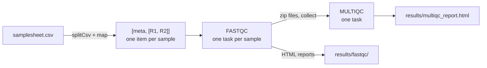

# Capstone 1: A QC pipeline from a samplesheet

!!! info "About this capstone"
    **You'll build:** a pipeline that reads a samplesheet of paired-end FASTQ files, runs **FastQC** on every sample in parallel, and combines all results into one **MultiQC** report. It's the first step of almost every sequencing analysis, and the first workflow in nf-core/rnaseq, nf-core/sarek and most other nf-core pipelines.

    **It uses:** samplesheets and meta maps (5.2, 5.4), processes with containers and conda (2.3, 4.1), `tag` and `cpus` (4.2), named outputs (4.4), `collect` (3.2, 5.3), publishing (3.3) and `-resume` (3.4).

    **Time:** 2 to 4 h · **Level:** Beginner (Level 1 final project) · **Needs:** Modules 1 to 5, Docker Desktop running (or conda)

    **Docs:** [FastQC](https://www.bioinformatics.babraham.ac.uk/projects/fastqc/) · [MultiQC](https://docs.seqera.io/multiqc) · [Workflow outputs](https://docs.seqera.io/nextflow/workflow#outputs)

!!! flo "Flo says"
    No new concepts today: only things you already know, put together. There's no step-by-step code on this page, only requirements, hints, and a checker. Take your time, and use the debugging loop from Lesson 4.3 when something fails.

---

## The goal



## Set up

```bash title="Terminal"
cd "$COURSE"/capstone1
bash ../module05_channels/get_data.sh      # the same real data as in Module 5
ls
```

| File | Status |
|---|---|
| `samplesheet.csv` | Ready: `sample,fastq_1,fastq_2` for `cov_a`, `cov_b` and `hsa_rna` |
| `nextflow.config` | Ready: `pipefail` for every task, publishing as copies, and the `docker` and `conda` profiles (with `--platform linux/amd64` for Apple Silicon) |
| `main.nf` | **Yours to write.** It only contains TODO comments. |
| `check_capstone.sh` | The checker |

```groovy title="nextflow.config (provided)"
--8<-- "capstone1/nextflow.config"
```

## Requirements

Your `main.nf` must:

1. **Parameter:** declare `input` (the samplesheet, a `Path`) in a `params` block, with the default `'samplesheet.csv'`.
2. **Channel:** build one item per sample, in the meta-map pattern `[meta, [R1, R2]]` with `meta.id` = the sample name. Check that every file exists.
3. **`FASTQC` process:**
    - one task per sample, tagged with `meta.id`, with `cpus 2`;
    - software: container `quay.io/biocontainers/fastqc:0.12.1--hdfd78af_0` and conda `bioconda::fastqc=0.12.1`;
    - run `fastqc` on both files of the sample, using `${task.cpus}` threads;
    - named outputs for the `.html` reports and the `.zip` files.
4. **`MULTIQC` process:**
    - **one** task, receiving **all** FastQC zip files;
    - software: container `quay.io/biocontainers/multiqc:1.35--pyhdfd78af_2` and conda `bioconda::multiqc=1.35`;
    - run `multiqc --filename multiqc_report.html .`, which writes the report and a `multiqc_report_data` folder.
5. **Publishing:** the FastQC HTML reports go in **`fastqc/`**; `multiqc_report.html` and its data folder go at the **top** of the output directory.
6. **No hard-coded sample names:** the checker uses a different samplesheet.
7. **`-resume`** must take every task from the cache on a second run.

Run it with:

```bash title="Terminal"
nextflow run main.nf -profile docker      # or: -profile conda
open results/multiqc_report.html
```

!!! info "The first run is slow, later runs are fast"
    On the test Mac, the first `-profile docker` run had to download the MultiQC image (1.33 GB, about 66 s); after that, the whole pipeline took **12 s**. The first `-profile conda` run took about **130 s**, while Nextflow built the two environments; they're reused afterwards.

## Hints

Try first, then open a hint only when you're stuck.

??? tip "Hint 1: the samples channel"
    Lesson 5.4, section C, has the exact `map` you need. Leave out `condition`: this samplesheet doesn't have it.

??? tip "Hint 2: FASTQC's inputs and outputs"
    Input: `tuple val(meta), path(reads)`. FastQC writes `<file>_fastqc.html` and `<file>_fastqc.zip` for each input file, so glob outputs work: `tuple val(meta), path('*.html'), emit: html`, and the same for `*.zip`. Add `--quiet` to keep FastQC's log short.

??? tip "Hint 3: from FASTQC to MULTIQC"
    MULTIQC needs only the files, not the meta maps, and all of them at once. Three operators: `map` (drop the meta), `flatten` (each sample gives a list of 2 zips) and `collect`. Its input is then simply `path qc_files`.

??? tip "Hint 4: publishing"
    Name the outputs in `publish:` (for example `fastqc = FASTQC.out.html`) and give each one a `path` in the `output` block: `'fastqc'` or `'.'`. Workflow outputs also publish files nested inside `[meta, files]` tuples. MULTIQC must declare `multiqc_report_data` as an output to publish it.

??? tip "Hint 5: something failed"
    Lesson 4.3: read the error report, go to the work dir, read `.command.err`. With Docker, check that Docker Desktop is running; with conda, the first run needs internet access.

## Milestones

```quiz
id: c1-steps
type: steps
concept: capstone-1
label: "Milestones"
steps:
  - "The samples channel prints three `[meta, [R1, R2]]` items with `view()`."
  - "FASTQC runs 3 tasks, tagged `cov_a`, `cov_b` and `hsa_rna`."
  - "MULTIQC runs once and its report lists 6 FASTQ files."
  - "`results/` holds `fastqc/` with 6 HTML files, plus `multiqc_report.html`."
  - "A second run with `-resume` shows `cached:` for every task."
  - "`nextflow lint main.nf` reports no errors."
```

## Check it

The checker copies your `main.nf` (and the provided config), makes a **new** samplesheet with two samples called `pt01` and `pt02`, runs your pipeline, inspects the published files and MultiQC's data, then runs it again with `-resume`. It uses `-profile docker` if Docker is running, otherwise `-profile conda`.

```quiz
id: capstone1
type: check
concept: capstone-1
label: "Capstone 1: auto-checked"
check: capstone1
command: "bash check_capstone.sh"
solution: includes/solutions/capstone1/main.nf
hint: "Run it from the `capstone1` folder. If one criterion fails, the line after it says what the checker saw. To force conda: `CAPSTONE_PROFILE=conda bash check_capstone.sh`."
explain: "A complete, containerised, resumable QC pipeline driven by a samplesheet: Level 1 done!"
```

This is what the reference solution printed on the test Mac:

```text title="Real output: nextflow run main.nf -profile docker (reference solution)"
executor >  local (4)
[ce/bee934] FASTQC (cov_b)   | 3 of 3 ✔
[46/608d83] MULTIQC          | 1 of 1 ✔
```

## Reflect

```quiz
id: c1-reflect
type: open
concept: capstone-1
question: "Your lab gets 96 new samples next week, sequenced on 4 lanes each. What would you change in your pipeline and samplesheet, and what would stay exactly the same?"
model: "The samplesheet grows: either one row per lane (and then the lanes of a sample are grouped, for example with groupTuple on meta.id, or each lane is QC'd separately), or one row per sample after merging lanes. The processes stay the same: FASTQC already runs once per item, in parallel, and MULTIQC already collects everything. On the cluster, only the configuration changes: a SLURM profile (Module 7) and Apptainer instead of Docker. Nothing in the code depends on the number of samples."
explain: "Good pipelines scale by changing the input, not the code."
```

!!! flo "Level 1 complete!"
    You started with "what is a workflow?" and finished with a real, containerised, resumable QC pipeline on real data. Level 2 builds on it: modules, configuration, SLURM, debugging and testing, then real alignment and variant calling. Ask Claude for the next module whenever you're ready.

---

## Your progress

<div class="nb-lesson-progress" data-lesson="5.5"></div>
